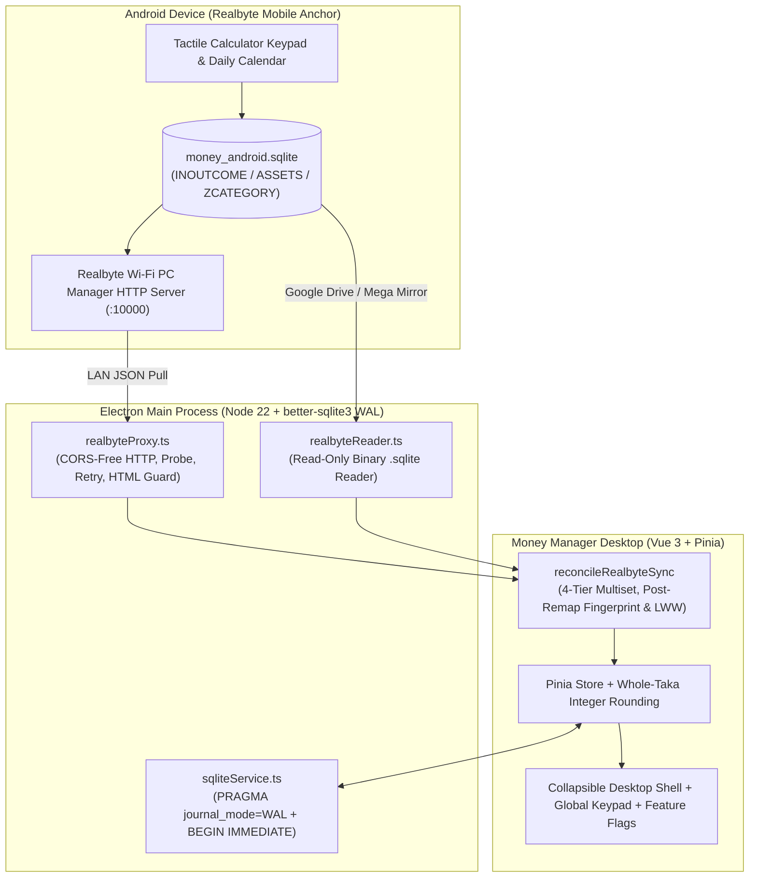

# Money Manager

[](https://github.com/Mostakim2005/money-manager/actions/workflows/ci.yml)
[](https://github.com/Mostakim2005/money-manager/releases/latest)
[](LICENSE)

Desktop **Personal Finance & Money Manager** built with **Electron + Vue 3 + TypeScript + `better-sqlite3` (WAL) + Tailwind CSS**, delivering Realbyte Money Manager parity with a modular feature-flag architecture (`Pure Realbyte Minimal Mode` vs `Full Suite`), Bangladesh **Sanchaypatra / FDR / DPS** calculators, **Actual Budget** rule & statement engines, and **collision-free Wi-Fi & binary `.sqlite` synchronization** with the Realbyte Android app.

---

## Pre-Built Downloads (GitHub Cloud Releases)

Portable Windows executables are compiled automatically in the cloud via GitHub Actions (`.github/workflows/ci.yml`) and attached to [GitHub Releases](https://github.com/Mostakim2005/money-manager/releases/latest):

| Platform / Architecture | Binary Artifact | Format |
| --- | --- | --- |
| **Windows x64 (Portable)** | [`money-manager-windows-portable.exe`](https://github.com/Mostakim2005/money-manager/releases/latest) | Standalone Electron portable executable (zero installation required) |

---

## System Architecture



---

## Core Features

1. **Realbyte Parity & Adaptive Desktop Workspace**
   - **Master-Detail Calendar (`CalendarTab.vue`):** Month grid showing daily income/expense sums (`Fri`/`Sat` Bangladesh weekends) alongside a sticky Day Transaction Sheet with inline Edit and Delete/Undo.
   - **Single Global Math Keypad (`TransactionKeypad.vue`):** Triggered globally via `N` or `Ctrl+K` with safe arithmetic evaluation, subcategories, optional multi-currency FX conversion, and receipt attachments.
   - **Dense Sortable Ledger (`TransactionsTab.vue`):** Multi-facet filters, accessible `aria-sort` columns, bulk Merge / Re-categorize / Delete, and transaction Split.
   - **Modular Feature Flags (`SettingsTab.vue`):** 1-click **Pure Realbyte Minimal Mode** vs **Full Suite** presets plus 13 individual module toggles and Privacy Mode (`Shift+P`).

2. **Bangladesh Fixed-Income & Planning Suite**
   - **Sanchaypatra, FDR & DPS (`SanchaypatraTab.vue`):** Cumulative holdings slab offsetting, 5%/10% AIT withholding, editable statutory slab rate tables, premature encashment simulator, and FDR/DPS maturity tracking.
   - **Visual Charts & Planning (`AnalyticsCharts.vue`, `PlanningTab.vue`):** SVG category donut, 6M/12M income vs expense & net worth trajectory charts, Savings Goals, Credit Card EMI tracker, and Lent/Borrowed IOU Khata.
   - **Account Reconciliation (`AccountsTab.vue`):** 1-click statement balance reconciliation creating whole-Taka `"Balance Adjustment"` delta transactions, plus Edit & Archive.

3. **Collision-Free Dual-Path Sync & Security**
   - **Realbyte Proxy + Diagnostics (`realbyteProxy.ts`):** CORS-free Node HTTP proxy with endpoint probing, custom path overrides, 90-day chunked history fetching, Dry-Run diff preview modal, and persistent `sync_logs`.
   - **Native SQLite WAL & Binary Reader (`sqliteService.ts`, `realbyteReader.ts`):** Automatic 1-time `localStorage` migration into `money_manager.sqlite` (`PRAGMA journal_mode=WAL`), native file dialogs, and direct binary `money_android.sqlite` parsing.
   - **AES-256-GCM Encrypted Vaults (`vaultCrypto.ts`):** PBKDF2-SHA256 encrypted JSON backup export and passphrase-protected restore.

---

## Local Development & Verification

```bash
# Install dependencies
npm install

# Run full Vitest verification suite (Sanchaypatra, Sync, Electron SQLite WAL, Proxy & Power Modules)
npm test

# Typecheck Vue + Electron TypeScript & build production web bundle
npm run build

# Bundle Electron Main & Preload scripts
npm run electron:compile

# Launch Electron desktop app locally
npm run electron:dev
```

---

## Documentation Suite (`docs/`)

- **[`docs/PRODUCT.md`](docs/PRODUCT.md)** — Product vision, user experience requirements, and active feature anchors.
- **[`docs/ARCHITECTURE.md`](docs/ARCHITECTURE.md)** — Subsystem mechanics, Mermaid dataflow diagrams, and verification commands.
- **[`docs/DECISIONS_AND_TRAPS.md`](docs/DECISIONS_AND_TRAPS.md)** — Architectural pivot history and critical engineering traps.
- **[`docs/VISUAL_LOG.md`](docs/VISUAL_LOG.md)** — Color-coded Obsidian & GitHub Mermaid flowcharts with plain-English feature walkthroughs.
- **[`THIRD_PARTY_NOTICES.md`](THIRD_PARTY_NOTICES.md)** — Attribution and license notices for upstream engines and dependencies.
- **[`LICENSE`](LICENSE)** — PolyForm Noncommercial License 1.0.0.
