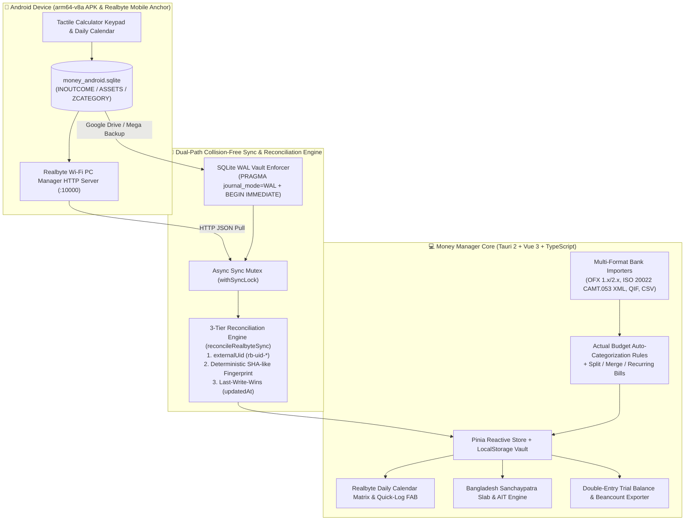

# Money Manager

[](https://github.com/Mostakim2005/money-manager/actions/workflows/ci.yml)
[](https://github.com/Mostakim2005/money-manager/releases/latest)
[](LICENSE)

Cross-platform **Personal Finance & Money Manager** built with **Tauri 2 + Vue 3 + TypeScript + Tailwind CSS**, delivering full visual and functional parity with **Realbyte's Money Manager**, specialized **Bangladesh Sanchaypatra** (National Savings Certificate) tiered slab & AIT profit tracking, **Actual Budget** multi-format bank statement importers/exporters and rule engines, and **dual-path collision-free synchronization** across Windows PC and Android (`arm64-v8a`).

---

## Pre-Built Downloads (GitHub Cloud Releases)

All desktop and mobile binaries are compiled automatically in the cloud via GitHub Actions (`.github/workflows/ci.yml`) and attached to [GitHub Releases](https://github.com/Mostakim2005/money-manager/releases/latest):

| Platform / Architecture | Binary Artifact | Format |
| --- | --- | --- |
| **Windows x64 (Portable)** | [`money-manager-windows-portable.exe`](https://github.com/Mostakim2005/money-manager/releases/latest) | Standalone portable executable (zero installation required) |
| **Windows x64 (Installer)** | [`money-manager-windows-setup.exe`](https://github.com/Mostakim2005/money-manager/releases/latest) / `.msi` | Standard Windows NSIS & MSI setup installers |
| **Android (`arm64-v8a` / AArch64)** | [`money-manager-android-arm64.apk`](https://github.com/Mostakim2005/money-manager/releases/latest) | Signed Android `arm64-v8a` APK package |

---

## System Architecture



---

## Core Features

1. **Realbyte Money Manager Visual & Functional Parity**
   - **Daily Calendar Grid (`CalendarTab.vue`):** Month matrix displaying daily income (green), expense (red), and net totals inside each date cell (`320px` responsive reflow and 200% zoom resilience) with a daily transaction drilldown sheet.
   - **Tactile Calculator Keypad (`TransactionKeypad.vue`) & Global Quick-Log FAB (`+`):** 1-tap floating action button accessible from any screen with built-in safe arithmetic evaluation (`+`, `-`, `×`, `÷` without `eval()`), category pills, payment chips (Cash, Bank, bKash, Nagad, Credit Card), and atomic account-to-account transfers.
   - **Full Transaction Lifecycle (`TransactionsTab.vue`):** Edit (`✏️`), Split (`✂️`), Merge, and Delete (`🗑️`) with an immediate **Undo Delete** recovery banner (`undoLastDelete`).
   - **Calibrated Light & Dark Themes (`style.css`):** 1-click theme switcher (`☀️ Light` / `🌙 Dark`) engineered with WCAG AA/AAA contrast ratios and zero text-contrast inversions.

2. **Bangladesh Sanchaypatra & Fixed Deposit Tracker (`SanchaypatraTab.vue`)**
   - Built-in statutory schemes (`5-Year Bangladesh Sanchaypatra`, `Paribar Sanchaypatra`, `3-Monthly Profit-Bearing Sanchaypatra`, `Pensioner Sanchaypatra`) with tiered principal slabs (`≤ 15 Lakh`, `15–30 Lakh`, `> 30 Lakh BDT`), mandatory **Advance Income Tax (AIT: 5% vs. 10%)** withholding math, maturity countdowns, and 1-click profit payout posting.

3. **Dual-Path Collision-Free Synchronization (`SettingsTab.vue`)**
   - **Path 1 — Realbyte Wi-Fi PC Manager (`RealbytePcManagerClient`):** Connects directly to the Realbyte mobile HTTP server (`port 10000`) and normalizes `INOUTCOME`, `ASSETS`, and `ZCATEGORY` payloads.
   - **Path 2 — SQLite Backup Vault (`sqliteVault.ts`):** Parses `money_android.sqlite` / `.sql` / `.json` vault backups synced via Google Drive or Mega while enforcing `PRAGMA journal_mode=WAL;`, `PRAGMA busy_timeout=5000;`, and `BEGIN IMMEDIATE` atomic transactions.
   - **Zero-Duplicate Reconciliation (`reconcileRealbyteSync`):** Matches records across both paths via `externalUid` (`rb-uid-*`), deterministic content fingerprints (`computeTransactionFingerprint`), and `updatedAt` Last-Write-Wins timestamps, serialized via `withSyncLock`.

4. **Harvested Open-Source Financial Engines (`Wealth-Apps/`)**
   - **Multi-Format Bank Statement Importers:** Supports **OFX 1.x/2.x (SGML & XML)**, **ISO 20022 CAMT.052/053 XML**, **QIF**, and **Bangladeshi Bank CSV** statements (City Bank, BRAC Bank, Sonali Bank, bKash) with FITID/fingerprint deduplication.
   - **RFC-4180 CSV & Full Vault JSON Exporters:** Includes spreadsheet formula-injection sanitization (`=`, `+`, `-`, `@`).
   - **Auto-Categorization Rules, Split/Merge & Recurring Schedules:** Adapted from Actual Budget's TypeScript engine.
   - **Double-Entry Accounting Bridge & Beancount Exporter:** Automatically maps single-entry logs and transfers into balanced `Debit = Credit` journal postings with live Trial Balance verification and plain-text **Beancount** export.

---

## Local Development & Verification

```bash
# Install dependencies
npm install

# Run the 60-test Vitest verification suite (Sanchaypatra math, Dual Sync, Concurrency, OFX/CAMT/Ledger)
npm test

# Typecheck & build production web bundle
npm run build

# Start Vite development server
npm run dev
```

---

## Documentation Suite (`docs/`)

- **[`docs/PRODUCT.md`](docs/PRODUCT.md)** — Product vision, user experience requirements, and active feature anchors.
- **[`docs/ARCHITECTURE.md`](docs/ARCHITECTURE.md)** — Subsystem mechanics, Mermaid dataflow diagrams, and extension recipes.
- **[`docs/DECISIONS_AND_TRAPS.md`](docs/DECISIONS_AND_TRAPS.md)** — Architectural pivot history and critical engineering traps (SQLite WAL concurrency, Sanchaypatra slab math, progressive documentation).
- **[`THIRD_PARTY_NOTICES.md`](THIRD_PARTY_NOTICES.md)** — Attribution and license notices for upstream engines and dependencies.
- **[`LICENSE`](LICENSE)** — PolyForm Noncommercial License 1.0.0.
