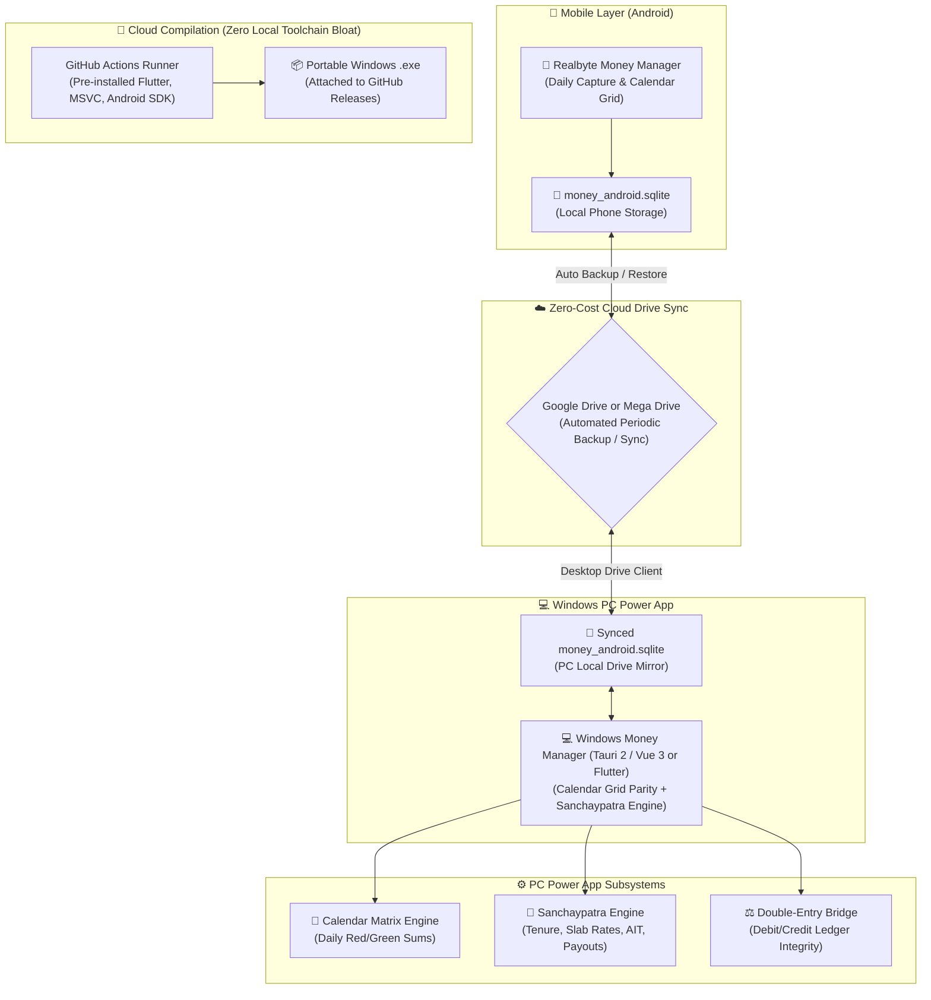
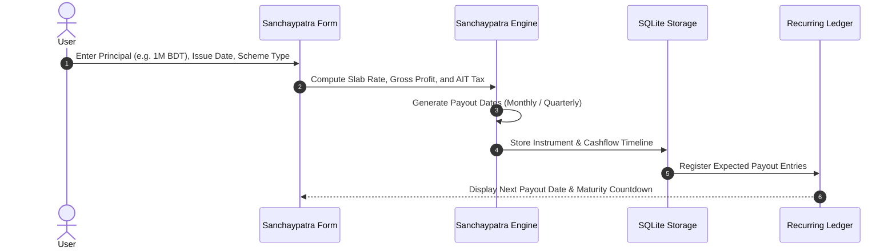
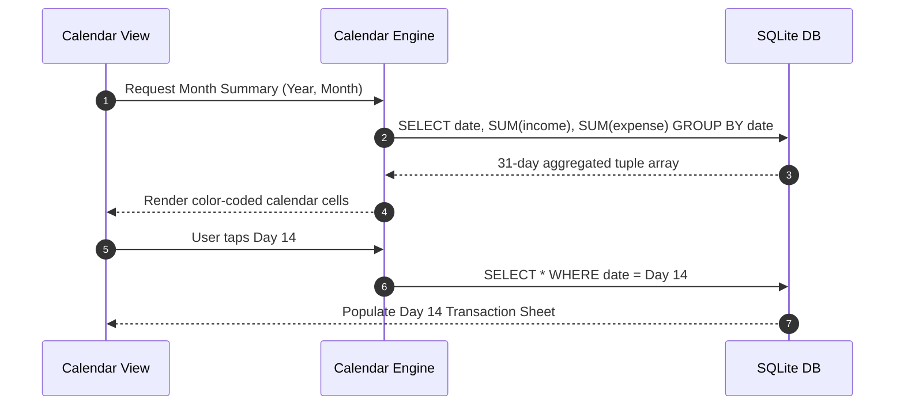

# System Architecture (`ARCHITECTURE.md`)
> **1-Line Summary:** Plain-English architectural blueprint and visual component maps for the cross-platform Realbyte-style Money Manager and Sanchaypatra tracking engine.

## 1. High-Level Visual System Map

---

## 2. Tech Stack Rationale & Candidate Matrix

| Layer | Recommended Tool / Library | Plain-English Reason Why |
| --- | --- | --- |
| **Mobile Capture Client** | **Realbyte Money Manager (Android)** | Preserves the user's preferred tactile UX, fast calculator entry, and local database without rebuilding mobile from scratch. |
| **PC Power App Shell** | **Tauri 2 + Vue 3 / React (or Flutter Desktop)** | Tiny (~15MB), fast native Windows desktop executable with Realbyte calendar parity and custom Sanchaypatra tabs. |
| **Core Database Engine** | **SQLite (`money_android.sqlite`)** | Universal format shared directly between Realbyte Android and the PC Power App. |
| **Sync Protocol** | **Google Drive / Mega Drive Client** | Zero subscription cost, 100% private, automated background file syncing. |
| **Build & Packaging Engine** | **GitHub Actions Cloud CI** | Eliminates 25–35 GB of local SDK downloads (MSVC, Android SDK, Flutter); compiles portable `.exe` in the cloud. |

---

## 3. Core Subsystems & Engineering Tricks

### [SUBSYSTEM: Actual-Budget-Cherry-Picked-Engines] | Aliases: actual budget rules, auto categorization, csv ofx importer
> **1-Line Summary:** Direct port of Actual Budget's TypeScript rules engine and statement parsers into the Vue 3 / Tauri application without adopting envelope budgeting.
* **How It Works (Plain English):** Actual Budget's codebase contains modular TypeScript utilities for automated categorization rules ("if Payee contains X, set Category Y") and multi-format bank statement parsing (CSV, QIF, OFX). Because our PC Power App is built in TypeScript (Vue 3 + Tauri 2), we directly port these utility modules without language translation, granting smart auto-tagging while preserving Realbyte's simple cashflow ledger model.
* **Code Anchors (Grep Targets):**
  * `src/modules/rules/` -> `RuleEngine`, `applyRules`
  * `src/modules/importers/` -> `parseBankStatement`

---

### [SUBSYSTEM: Sanchaypatra-Profit-Engine] | Aliases: sanchaypatra calculation, profit schedule, ait tax deduction, savings scheme
> **1-Line Summary:** Automated calculation of monthly/quarterly profits and tax deductions for Bangladeshi savings schemes based on government slab rules.
* **How It Works (Plain English):** When a user inputs a Sanchaypatra purchase (e.g., 5-Year Bangladesh Sanchaypatra for BDT 1,000,000), the engine reads the active government slab rates, calculates the gross annual return, subtracts the applicable Advance Income Tax (AIT: 5% up to 500k, 10% above), generates a schedule of upcoming profit payout dates, and links them to the destination bank account (e.g., Sonali Bank).
* **Data Flow Diagram:**

* **Code Anchors (Grep Targets):**
  * `src/modules/sanchaypatra/` -> `calculateNetProfit`, `generatePayoutSchedule`

---

### [SUBSYSTEM: Calendar-Matrix-Engine] | Aliases: calendar aggregation, daily totals, expense matrix, date grouping
> **1-Line Summary:** Fast daily aggregation engine summarizing income (green) and expense (red) per calendar day without lag.
* **How It Works (Plain English):** Aggregates transactions by `date(timestamp)` using a single optimized SQL query for the selected month, returning a matrix of daily net numbers that populates the calendar grid instantly without loading individual transaction records into memory until a day is tapped.
* **Data Flow Diagram:**

* **Code Anchors (Grep Targets):**
  * `src/modules/calendar/` -> `getMonthSummary`, `getDayTransactions`

---

### [SUBSYSTEM: Cross-Device-Local-Sync] | Aliases: sync protocol, wifi sync, webdav sync, cloud delta
> **1-Line Summary:** Peer-to-peer or lightweight cloud delta synchronizer keeping phone and PC databases aligned without subscription servers.
* **How It Works (Plain English):** Transactions are assigned a monotonic version or UUID and modified timestamp. When Phone and PC connect on the same local Wi-Fi network (or via WebDAV / free cloud API), the sync engine exchanges deltas, resolves conflicts via last-write-wins (LWW) per transaction ID, and writes updates in a single database transaction.
* **Code Anchors (Grep Targets):**
  * `src/modules/sync/` -> `syncWithPeer`, `resolveDeltas`

---

## 4. Verification & Health Checks

### [VERIFY: Automated-Check-Suite] | Aliases: build test, verify logic, typecheck, lint
> **1-Line Summary:** Standardized commands to verify mathematical accuracy, sync consistency, and build readiness.
* **Type & Logic Verification:** `npm run test` or `flutter test` (verifying Sanchaypatra slab calculations and calendar aggregations).
* **Code Quality & Linting:** `npm run lint` or `flutter analyze`.
* **Portable Desktop Build:** `npm run build:windows` or `flutter build windows`.
* **Mobile APK Build:** `npm run build:android` or `flutter build apk --release`.

---

## 5. Recipes: How to Add New Things Safely

* **To add a new Savings Scheme (e.g., Paribar Sanchaypatra or 3-Month Profit):**
  1. Define the scheme parameters in `src/modules/sanchaypatra/schemes.json` (tenure, payout interval, slab tiers).
  2. Implement any special withholding/tax logic in `SanchaypatraEngine` -> `calculateNetProfit`.
  3. Register UI label and icon in `SchemePickerComponent`.
