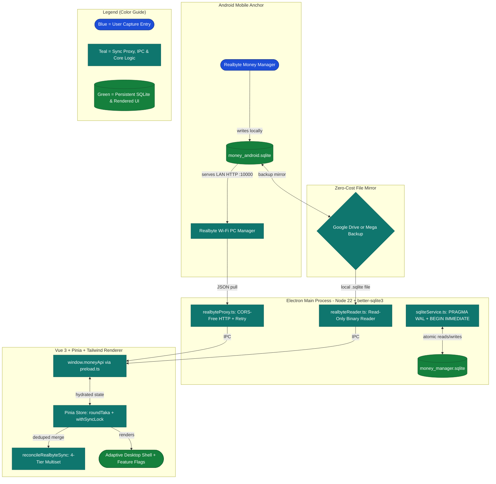
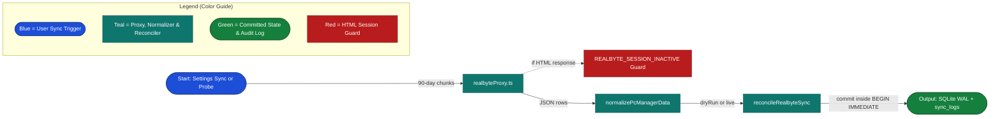

# System Architecture (`ARCHITECTURE.md`)
> **1-Line Summary:** Plain-English architectural blueprint and visual component maps for the Electron + Vue 3 + `better-sqlite3` WAL Money Manager desktop application and Realbyte sync architecture.

## 1. High-Level Visual System Map
* **Plain-English Overview:** Mobile logging stays on the Realbyte Android app, which shares data over Wi-Fi (`:10000`) or Google Drive / Mega `.sqlite` files into Electron's Node main process (`better-sqlite3` WAL + CORS-free HTTP proxy), feeding the reactive Vue 3 + Pinia desktop workspace.

---

## 2. Tech Stack Rationale & Candidate Matrix

| Layer | Active Technology | Plain-English Reason Why |
| --- | --- | --- |
| **Mobile Capture Client** | **Realbyte Money Manager (Android)** | Preserves fast mobile logging and local `.sqlite` backup portability without building a separate mobile app first. |
| **Desktop Shell** | **Electron + Vue 3 + TypeScript + Tailwind CSS** | Eliminates WebView CORS blocks against Realbyte `:10000`, bundles offline `@fontsource/inter`, and ships a clean portable Windows `.exe`. |
| **Local Storage Engine** | **`better-sqlite3` (`shared/schema/v1_core.sql`)** | Native WAL-mode SQLite persistence storing whole-Taka `INTEGER` money columns and reading real binary `money_android.sqlite` backups directly. |
| **Sync & Security** | **Node HTTP Proxy + WebCrypto AES-256-GCM** | Direct LAN HTTP polling with retry/HTML detection, 4-tier multiset deduplication, and passphrase-encrypted JSON vault backups. |
| **Build & Packaging** | **GitHub Actions + `electron-builder`** | Compiles and packages `money-manager-windows-portable.exe` cleanly on `windows-latest` CI runners. |

---

## 3. Core Subsystems & Engineering Tricks

### [SUBSYSTEM: Electron-SQLite-WAL-And-Binary-Bridge] | Aliases: electron main, preload ipc, better-sqlite3, v1_core schema, localStorage migration
> **1-Line Summary:** Native `better-sqlite3` WAL database service in Electron Main Process with automatic one-time `localStorage` migration and read-only Realbyte binary `.sqlite` inspection.
* **How It Works (Plain English):** `MoneySqliteService` opens `money_manager.sqlite` in Electron's `userData` folder with `PRAGMA journal_mode=WAL;`, `PRAGMA synchronous=NORMAL;`, `PRAGMA busy_timeout=5000;`, and `PRAGMA foreign_keys=ON;`. Schema tables from `shared/schema/v1_core.sql` enforce whole-Taka `INTEGER` columns. On startup, `hydrateFromElectronDb` checks if SQLite is initialized; if not, it automatically migrates existing `localStorage` state into SQLite inside an atomic `BEGIN IMMEDIATE ... COMMIT` block. Separately, `readRealbyteBinarySqlite` reads Android `money_android.sqlite` files in read-only mode so users never need manual SQL/JSON conversion.
* **Code Anchors (Grep Targets):**
  * `shared/schema/v1_core.sql` -> `accounts`, `transactions`, `sync_logs`
  * `electron/db/sqliteService.ts` -> `MoneySqliteService`, `saveFullState`, `loadFullState`
  * `electron/db/realbyteReader.ts` -> `readRealbyteBinarySqlite`
  * `electron/main.ts` -> `registerIpcHandlers`, `createMainWindow`
  * `electron/preload.ts` -> `contextBridge.exposeInMainWorld`

---

### [SUBSYSTEM: Realbyte-CORS-Free-Sync-And-Reconciliation] | Aliases: realbyte proxy, dry run sync, multiset reconciliation, endpoint probe, sync logs
> **1-Line Summary:** Node-level Realbyte HTTP proxy with endpoint probing, 90-day chunked historical fetching, HTML session-expired detection, and non-mutating Dry-Run reconciliation previews.
* **How It Works (Plain English):** Settings invokes `probeRealbyteEndpoints` or `syncFromPcManager` through the Electron Node proxy, splitting large date scopes into 90-day chunks while guarding against inactive HTML login screens. Incoming rows are normalized (`DO_TYPE` 3/4 transfer pairs collapsed), previewed safely in Dry-Run mode, and finally merged into `money_manager.sqlite` + `sync_logs`.
* **Data Flow Diagram:**

* **Code Anchors (Grep Targets):**
  * `electron/net/realbyteProxy.ts` -> `probeRealbyteEndpoints`, `fetchRealbyteTransactions`
  * `src/modules/realbyte/client.ts` -> `RealbytePcManagerClient`, `fetchTransactionsChunked`, `normalizePcManagerData`
  * `src/modules/sync/syncCoordinator.ts` -> `reconcileRealbyteSync`, `computeTransactionFingerprint`

---

### [SUBSYSTEM: Sanchaypatra-FDR-DPS-And-Analytics] | Aliases: sanchaypatra slab, early encashment, fdr dps calculator, visual svg charts
> **1-Line Summary:** Cumulative slab Sanchaypatra engine with editable statutory tables, premature surrender calculator, FDR/DPS maturity math, and SVG cashflow/net-worth trend analytics.
* **Code Anchors (Grep Targets):**
  * `src/modules/sanchaypatra/calculator.ts` -> `calculateSanchaypatraProfit`, `calculateEarlyEncashment`, `addMonthsClampedISO`
  * `src/modules/sanchaypatra/fdrDpsCalculator.ts` -> `calculateFdrMaturity`, `calculateDpsMaturity`
  * `src/modules/statistics/analytics.ts` -> `computePeriodAnalytics`, `computeMonthlyTrend`, `computeNetWorthTrend`
  * `src/components/AnalyticsCharts.vue` -> `donutSegments`, `monthlyTrend`, `netWorthTrend`

---

### [SUBSYSTEM: Actual-Budget-Harvested-Engines-And-Vault-Crypto] | Aliases: rules engine, csv ofx qif camt importer, split merge, encrypted json vault
> **1-Line Summary:** Ported Actual Budget TypeScript rules, RFC-4180 CSV / OFX / QIF / CAMT.053 parsers, double-entry Beancount bridge, and WebCrypto PBKDF2 + AES-256-GCM vault backup encryption.
* **Code Anchors (Grep Targets):**
  * `src/modules/rules/engine.ts` -> `applyRulesToTransaction`
  * `src/modules/importers/` -> `parseCsvStatement`, `parseQifContent`, `parseOfxStatement`, `parseCamtXmlStatement`
  * `src/modules/exporters/vaultCrypto.ts` -> `encryptVaultJson`, `decryptVaultJson`
  * `src/modules/ledger/doubleEntryBridge.ts` -> `generateDoubleEntryJournal`, `verifyLedgerTrialBalance`, `exportJournalToBeancount`

---

## 4. Verification & Health Checks

### [VERIFY: Automated-Check-Suite] | Aliases: build test, verify logic, typecheck, lint, electron compile
> **1-Line Summary:** Standardized verification commands covering Vue + Electron TypeScript checking, unit/integration Vitest suites, Vite build, and esbuild Electron compilation.
* **Logic, SQLite WAL & Proxy Tests:** `npm test`
* **Typecheck & Static Lint:** `npm run typecheck` and `npm run lint`
* **Production Web Bundle:** `npm run build`
* **Electron Main/Preload Bundle:** `npm run electron:compile`
* **Portable Windows Executable:** `npm run electron:build`
