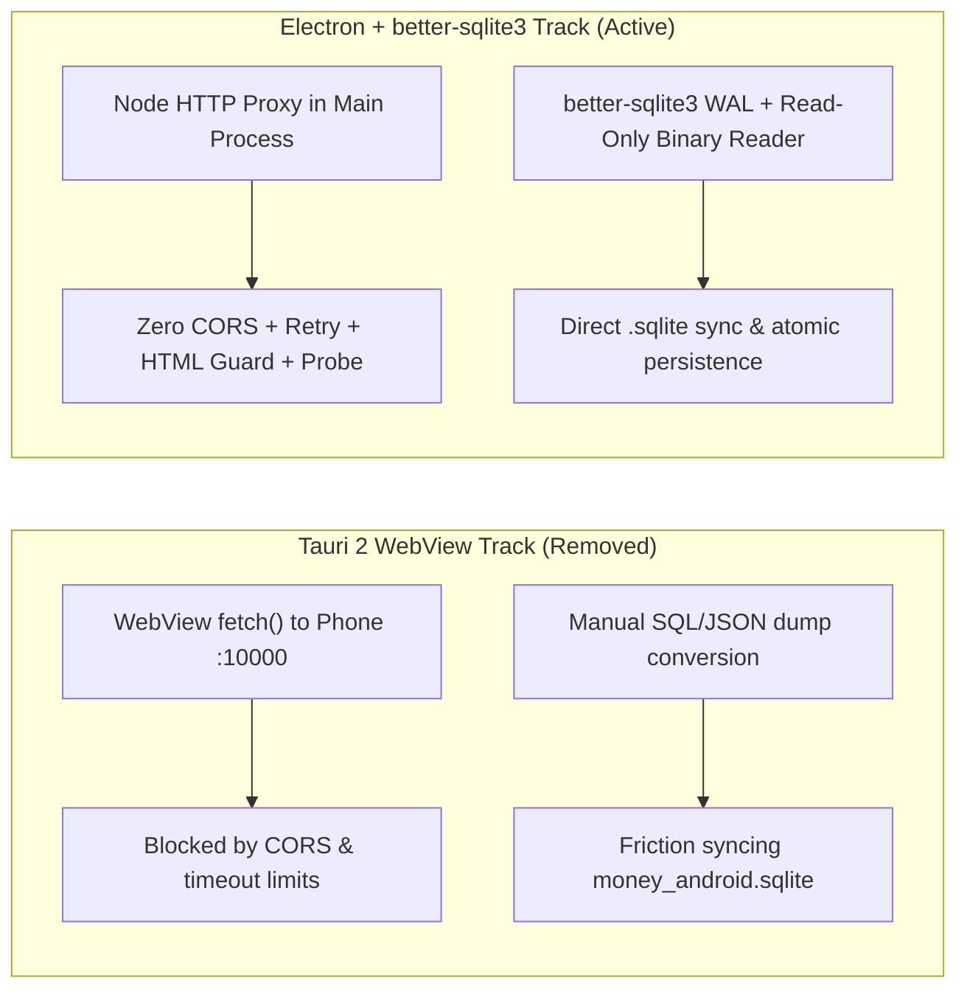

# Architectural Decisions, Pivots & Landmines (`DECISIONS_AND_TRAPS.md`)
> **1-Line Summary:** Records architectural pivots, Electron migration rationale, whole-Taka rounding standards, and non-obvious engineering landmines.

## 1. Architectural Decisions & Pivot History

### [DECISION: Local-Sanchaypatra-Over-Wall-Street-Bonds] | Aliases: sanchaypatra pivot, bond tracking pivot, savings certificate, fixed deposit
> **1-Line Summary:** Replaced international market bond tracking with localized Bangladesh National Savings Certificates (Sanchaypatra), FDR, and DPS modules.
* **Decision Maker:** `[DECIDED BY: HUMAN]`
* **Original User Intention:** Track fixed-return domestic savings instruments with government slab brackets, AIT tax deductions, and premature encashment penalties rather than Wall Street tickers.
* **Code Anchors (Grep Targets):**
  * `src/modules/sanchaypatra/calculator.ts` -> `calculateSanchaypatraProfit`, `calculateEarlyEncashment`
  * `src/modules/sanchaypatra/fdrDpsCalculator.ts` -> `calculateFdrMaturity`, `calculateDpsMaturity`

---

### [DECISION: Electron-Over-Tauri-Complete-Migration] | Aliases: electron over tauri, better-sqlite3, cors proxy, realbyte port 10000
> **1-Line Summary:** Migrated completely from Tauri 2 / Rust to Electron + `better-sqlite3` WAL + Node HTTP proxy to eliminate WebView CORS blocks and support native binary `money_android.sqlite` reading.
* **Decision Maker:** `[DECIDED BY: HUMAN]`
* **Original User Intention:** Enable reliable LAN syncing against Realbyte Android's port 10000 HTTP server, read real binary `.sqlite` backups directly on disk, and bundle everything cleanly into a portable Windows `.exe`.
* **Options Considered:**
  * **Option A (Rejected - Tauri 2 WebView + `localStorage`):** Browser `fetch()` inside WebView hit CORS restrictions against Realbyte's embedded phone server, and binary `.sqlite` files required manual conversion.
  * **Option B (Chosen - Electron + `better-sqlite3` + Node HTTP Proxy):** Node Main Process handles HTTP requests (`electron/net/realbyteProxy.ts`) with zero CORS issues, reads binary Android `.sqlite` files directly (`electron/db/realbyteReader.ts`), and persists app state in local WAL SQLite (`electron/db/sqliteService.ts`).
* **Visual Pivot Map (What Failed vs. What Works):**

* **Code Anchors (Grep Targets):**
  * `electron/main.ts` -> `registerIpcHandlers`
  * `electron/db/sqliteService.ts` -> `MoneySqliteService`
  * `electron/net/realbyteProxy.ts` -> `probeRealbyteEndpoints`

---

### [DECISION: Whole-Taka-Integer-Rounding-No-Paisa] | Aliases: whole taka, roundTaka, no paisa decimals, sqlite integer money
> **1-Line Summary:** Stored and computed all BDT monetary amounts in whole integer Taka (`roundTaka()`) instead of multiplying by 100 into paisa/cents.
* **Decision Maker:** `[DECIDED BY: HUMAN]`
* **Original User Intention:** Keep every number in TypeScript, SQLite (`INTEGER`), and UI identical to real-world Bangladeshi Taka cashflow without unnecessary `* 100` / `/ 100` scaling.
* **Code Anchors (Grep Targets):**
  * `shared/schema/v1_core.sql` -> `transactions`, `accounts`
  * `src/modules/accounts/transferEngine.ts` -> `roundTaka`

---

### [DECISION: Modular-Feature-Flags-Anti-Feature-Creep] | Aliases: feature flags, pure realbyte minimal mode, modular ui
> **1-Line Summary:** Gated all lateral power modules behind persisted `featureFlags` with 1-click Pure Realbyte Minimal Mode vs Full Suite presets.
* **Decision Maker:** `[DECIDED BY: HUMAN]`
* **Original User Intention:** Keep daily logging fast and uncluttered like Realbyte Money Manager while making Sanchaypatra, Charts, Envelope Budgets, Goals, CC EMIs, IOU Khata, Multi-Currency, and Encrypted Vaults individually toggleable.
* **Code Anchors (Grep Targets):**
  * `src/store/index.ts` -> `DEFAULT_FEATURE_FLAGS`, `applyFeaturePreset`, `setFeatureFlag`
  * `src/components/SettingsTab.vue` -> `featureFlagItems`

---

## 2. Do-Not-Touch Engineering Landmines (Traps)

### [TRAP: Electron-Asar-Unpack-And-Vite-Relative-Base] | Aliases: better-sqlite3 asar, vite base file url, blank white window
> **1-Line Summary:** Packaging Electron without `base: './'` in Vite or without unpacking `better-sqlite3` from ASAR produces a blank window or native `.node` load crash in portable `.exe` builds.
* **Strict Rule:** Keep `base: './'` in `vite.config.ts` and `"asarUnpack": ["node_modules/better-sqlite3/**/*"]` in `package.json`.
* **Protected Code Anchors (Grep Targets):**
  * `vite.config.ts` -> `base`
  * `package.json` -> `build`

---

### [TRAP: Raw-SQLite-Concurrency-And-Journal-Locking] | Aliases: sqlite locking, db corruption, wal mode, dual sync collision
> **1-Line Summary:** Always enforce `PRAGMA journal_mode=WAL;`, `BEGIN IMMEDIATE / COMMIT`, post-FK-remap fingerprint computation, and `reconcileRealbyteSync` to prevent DB locks or duplicate records.
* **Protected Code Anchors (Grep Targets):**
  * `electron/db/sqliteService.ts` -> `MoneySqliteService`, `saveFullState`
  * `src/modules/sync/syncCoordinator.ts` -> `reconcileRealbyteSync`, `computeTransactionFingerprint`
  * `src/store/index.ts` -> `withSyncLock`, `syncFromPcManager`, `syncFromSqliteVault`

---

### [TRAP: Sanchaypatra-Cumulative-Slab-And-AIT-Math] | Aliases: slab rate, cumulative holdings, ait tax, early encashment
> **1-Line Summary:** Offset tiered slab brackets by existing cumulative Sanchaypatra holdings (`existingHoldingsBDT`), clamp month-end dates without UTC drift, and apply 5%/10% AIT withholding.
* **Protected Code Anchors (Grep Targets):**
  * `src/modules/sanchaypatra/calculator.ts` -> `calculateSanchaypatraProfit`, `calculateEarlyEncashment`, `addMonthsClampedISO`

---

### [TRAP: Reintroducing-Deprecated-Index-Files] | Aliases: index.md trap, progressive documentation rule
> **1-Line Summary:** Never create `INDEX.md` or `00-INDEX.md`. Every documentation section lives in `docs/` using `### [TYPE: ...] | Aliases: ...` and a 1-line summary.
