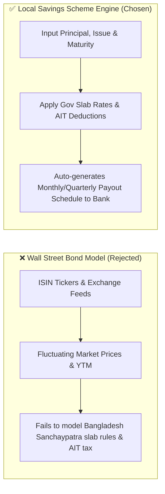
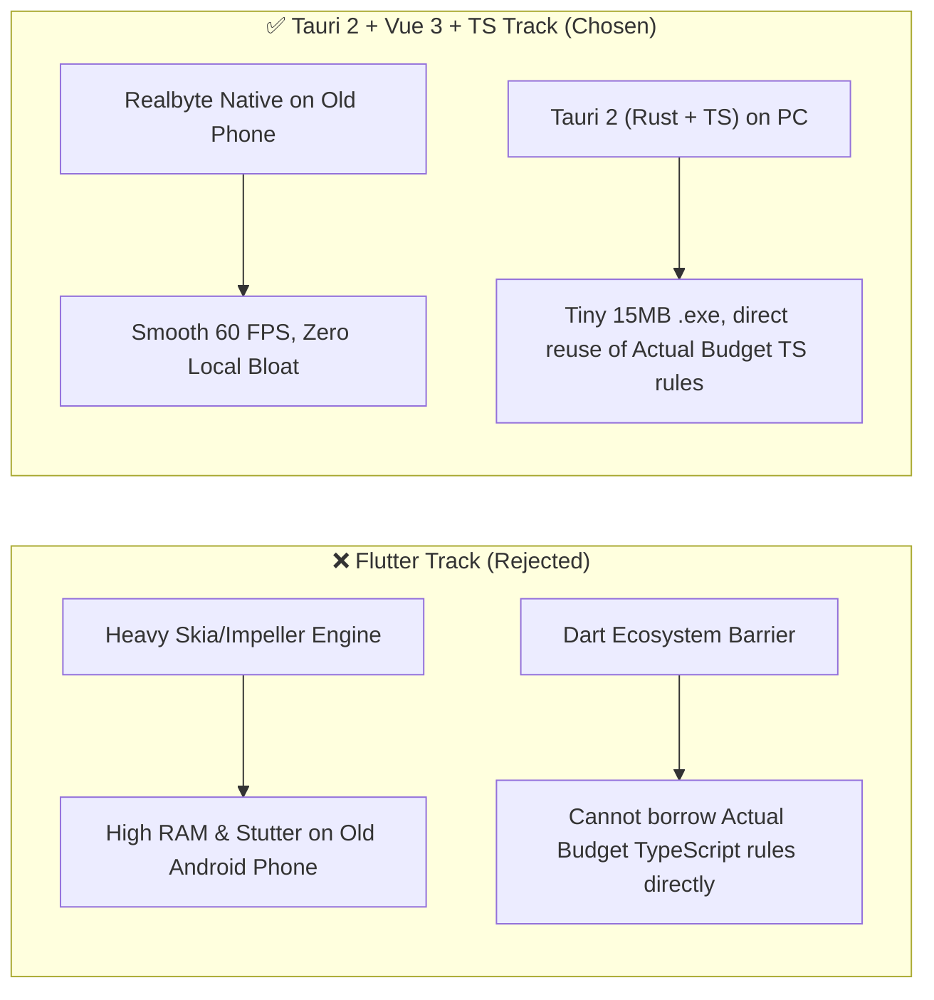
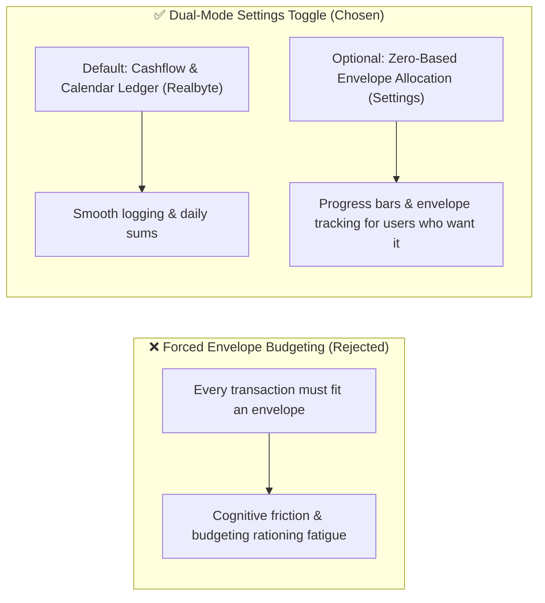
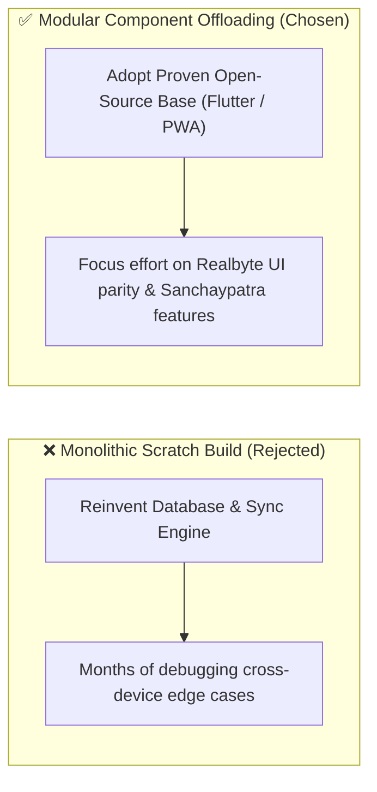
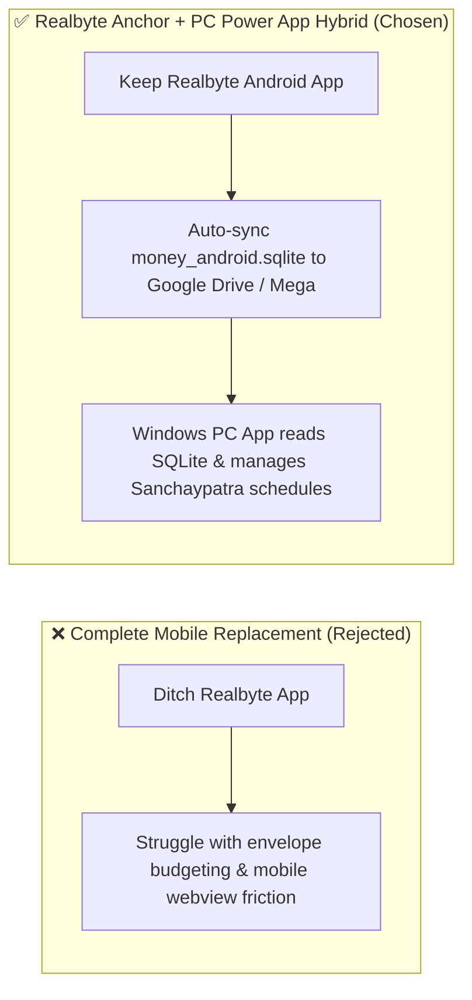
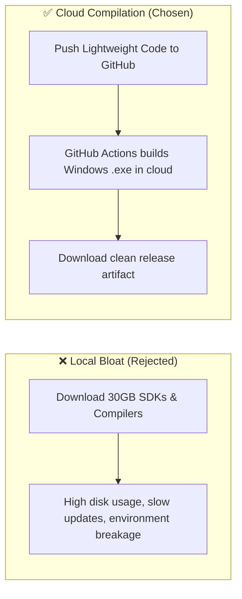

# Architectural Decisions, Pivots & Landmines (`DECISIONS_AND_TRAPS.md`)
> **1-Line Summary:** Records architectural pivots, rationale for localized savings schemes over Wall Street bonds, open-source component wrapping decisions, and critical engineering landmines.

## 1. Architectural Decisions & Pivot History

### [DECISION: Local-Sanchaypatra-Over-Wall-Street-Bonds] | Aliases: sanchaypatra pivot, bond tracking pivot, savings certificate, fixed deposit
> **1-Line Summary:** Replaced complex international market bond tracking with localized government savings certificates (Sanchaypatra) and fixed deposits.
* **Decision Maker:** `[DECIDED BY: HUMAN]`
* **Original User Intention:** The user needs to track invested wealth and returns, but specifically for domestic instruments like Bangladesh Sanchaypatra (National Savings Certificates) rather than publicly traded corporate/government bonds with fluctuating market prices and ISIN tickers.
* **Options Considered:**
  * **Option A (Rejected - Portfolio Performance / Wall Street Bond Model):** Treated bonds as publicly traded securities requiring ISINs, continuous quote feeds, and complex YTM calculations. Rejected because it does not fit fixed-return national savings schemes, lacks local tax slab awareness, and introduces unnecessary cognitive overhead.
  * **Option B (Chosen - Local Savings Scheme Module):** A streamlined custom asset entry capturing Principal, Issue Date, Maturity Date, Government Slab Rate, Payout Frequency (monthly/quarterly), and Advance Income Tax (AIT).
* **Visual Pivot Map (What Failed vs. What Works):**

* **Code Anchors (Grep Targets):**
  * `docs/PRODUCT.md` -> `Sanchaypatra-Scheme-Tracker`
  * `docs/ARCHITECTURE.md` -> `Sanchaypatra-Profit-Engine`

---

### [DECISION: Tauri-Vue-Over-Flutter-For-Old-Hardware-And-TypeScript-Parity] | Aliases: tauri vs flutter, vue vs dart, old phone constraint, actual budget rules port
> **1-Line Summary:** Selected Tauri 2 + Vue 3 + TypeScript over Flutter due to older mobile hardware constraints, smaller PC footprint, and direct code-level compatibility with Actual Budget's TypeScript rules engine.
* **Decision Maker:** `[DECIDED BY: HUMAN]`
* **Original User Intention:** Select the optimal base technology between Tauri 2 (Vue 3/TS) and Flutter, ensuring high performance on an older Android phone, low PC resource consumption, seamless Realbyte SQLite schema interop, and the ability to borrow specific features (rules engine, bank imports) from Actual Budget.
* **Options Considered:**
  * **Option A (Rejected - Flutter Desktop / Mobile):** Heavy runtime (~30MB APK baseline, 100–150MB RAM usage) that lags on older mobile hardware; requires manually rewriting Actual Budget's TypeScript logic into Dart.
  * **Option B (Chosen - Tauri 2 + Vue 3 / TypeScript Desktop with Realbyte Anchor):** Retains native Realbyte on the older Android phone (30MB RAM, zero lag); uses Windows WebView2 on PC (15MB portable `.exe`, ~45MB RAM); shares identical TypeScript ecosystem with Actual Budget, enabling direct reuse of its rule engine and CSV parsers.
* **Visual Pivot Map (What Failed vs. What Works):**

---

### [DECISION: Dual-Philosophy-Toggleable-Budgeting] | Aliases: cashflow vs envelope, budget philosophy toggle, realbyte mode vs actual mode
> **1-Line Summary:** Decoupled budgeting views into a settings toggle between "Cashflow & Calendar Ledger" (default) and "Zero-Based Envelope Allocation" without altering underlying SQLite transaction schemas.
* **Decision Maker:** `[DECIDED BY: HUMAN]`
* **Original User Intention:** Provide the option to experiment with zero-based envelope budgeting (Actual Budget philosophy) while keeping Realbyte's fluid cashflow and calendar grid as the primary default.
* **Options Considered:**
  * **Option A (Rejected - Hardcoded Envelope Architecture):** Forcing every transaction to draw from monthly allocated envelope pots (like YNAB / Actual Budget). Rejected because it breaks Realbyte's intuitive cashflow tracking.
  * **Option B (Chosen - UI-Layer Toggle over Uniform Schema):** The underlying database records standard transactions (`amount`, `category`, `account`, `date`). Toggling the mode simply shows/hides the monthly category allowance bars and envelope balances in the UI.
* **Visual Pivot Map (What Failed vs. What Works):**

---

### [DECISION: Component-Offloading-And-Forking-Over-Scratch-Build] | Aliases: fork vs build, offloading hard parts, open source wrapping
> **1-Line Summary:** Offloaded heavy database, UI, and synchronization layers to existing open-source libraries and repositories rather than writing a monolithic app from scratch.
* **Decision Maker:** `[DECIDED BY: HUMAN]`
* **Original User Intention:** Attain a complete, reliable Money Manager working smoothly on both PC and Phone with minimal wasted effort and robust data integrity.
* **Options Considered:**
  * **Option A (Rejected - Build Monolithic App From Scratch):** Handcrafting a new cross-platform app, database engine, sync protocol, and calculator from zero. Rejected due to excessive time-to-usability (3–6+ months) and high risk of sync race conditions.
  * **Option B (Chosen - Open-Source Component Wrapping & Forking):** Identify top open-source candidates (e.g., Cashew Flutter, ezBookkeeping Go/Vue PWA, or Actual Budget sync protocol), take their best components (database schema, calendar widget, sync layer), and inject the Realbyte-style keypad and Sanchaypatra module.
* **Visual Pivot Map (What Failed vs. What Works):**

---

### [DECISION: Realbyte-Mobile-Anchor-With-PC-Power-App-Hybrid] | Aliases: mobile realbyte anchor, pc power app, dual mode hybrid, google drive sync
> **1-Line Summary:** Preserves the beloved Realbyte Android app as the primary mobile logger while syncing the SQLite database to Google Drive / Mega for a Windows PC Power App.
* **Decision Maker:** `[DECIDED BY: HUMAN]`
* **Original User Intention:** The user loves the tactile workflow and philosophical simplicity of Realbyte's mobile app and rejects strict envelope budgeting tools (like Actual Budget) that force artificial constraints.
* **Options Considered:**
  * **Option A (Rejected - Replace Mobile App with Actual Budget or Full Custom Port):** Building or switching to a new mobile app immediately. Rejected due to high mobile development friction and philosophical mismatch with envelope budgeting.
  * **Option B (Chosen - Realbyte Mobile Anchor + Cloud Drive Sync + PC Power App):** Continue using Realbyte on Android; automate SQLite database backups (`money_android.sqlite`) to Google Drive or Mega; build a Windows PC Power App that shares the same database, provides desktop calendar analysis, and adds Sanchaypatra tracking.
* **Visual Pivot Map (What Failed vs. What Works):**

---

### [DECISION: Cloud-CI-Over-Local-Heavy-Toolchains] | Aliases: github actions builds, no local sdk bloat, tag-triggered portable exe
> **1-Line Summary:** Offloaded all heavy SDKs and compilers (Flutter, Android SDK, Visual Studio C++) to GitHub Actions, eliminating 25–35 GB of local bloat.
* **Decision Maker:** `[DECIDED BY: HUMAN]`
* **Original User Intention:** Avoid bloating the local PC with massive developer toolchains while still producing native Windows portable `.exe` and Android binaries.
* **Options Considered:**
  * **Option A (Rejected - Local Heavy SDK Installation):** Installing 25–35 GB of Visual Studio C++ build tools, Android SDK/NDK, and Flutter locally.
  * **Option B (Chosen - Tag-Triggered GitHub Actions Cloud Builds):** Keep local repository lightweight (<50 MB clean source code); configure GitHub Actions to build portable Windows executables and mobile APKs on version tag push.
* **Visual Pivot Map (What Failed vs. What Works):**

---

### [DECISION: Realbyte-Money-Manager-UX-Parity] | Aliases: realbyte parity, daily calendar, quick entry keypad
> **1-Line Summary:** Standardized the core user interaction model around Realbyte's "Money Manager Expense & Budget".
* **Decision Maker:** `[DECIDED BY: HUMAN]`
* **Original User Intention:** The user is an active daily user of Realbyte's Money Manager and needs an open-source/customizable solution that feels immediately familiar without cognitive friction.
* **Options Considered:**
  * **Option A (Rejected - Traditional Desktop Ledger / Accounting Screen):** Dense tabular views like GnuCash or KMyMoney. Rejected because it is too slow for quick mobile logging.
  * **Option B (Chosen - Realbyte-Style Fast Logging & Calendar Matrix):** Dedicated numeric keypad entry paired with a color-coded daily calendar (green income, red expense) and monthly summary banners.

---

## 2. Do-Not-Touch Engineering Landmines (Traps)

### [TRAP: Raw-SQLite-Concurrency-And-Journal-Locking] | Aliases: sqlite locking, db corruption, wal mode, dual sync collision
> **1-Line Summary:** Writing to SQLite files across devices without Write-Ahead Logging (WAL), atomic transactions, and deterministic fingerprint deduplication causes file corruption or duplicate transactions.
* **Strict Rule:** **NEVER** perform direct multi-device writes or sync raw SQLite database files while the database connection is open without enabling `PRAGMA journal_mode=WAL;` and wrapping sync updates inside atomic transaction boundaries (`BEGIN IMMEDIATE / COMMIT`). Furthermore, **ALWAYS** pass incoming records from both Realbyte PC Manager (Wi-Fi) and SQLite backup vaults (`money_android.sqlite`) through `reconcileRealbyteSync` (`externalUid` + `computeTransactionFingerprint` + Last-Write-Wins `updatedAt`) so switching between Wi-Fi sync and SQLite backup files never produces duplicate transactions or balance collisions.
* **Why This Trap Exists (Plain English):** SQLite locks the database file during writes, and syncing the same phone data via both Wi-Fi HTTP and SQLite backup files without shared UID/fingerprint reconciliation would otherwise double-count transactions and corrupt account balances.
* **Protected Code Anchors (Grep Targets):**
  * `src/modules/database/sqliteVault.ts` -> `createSQLiteConnection`, `parseRealbyteSqliteVault`
  * `src/modules/sync/syncCoordinator.ts` -> `reconcileRealbyteSync`, `computeTransactionFingerprint`

---

### [TRAP: Sanchaypatra-Slab-Rate-AIT-Miscalculation] | Aliases: slab rate, ait tax, withholding desync
> **1-Line Summary:** Applying a single flat interest rate across the entire Sanchaypatra balance violates Bangladeshi tax law and breaks profit accuracy.
* **Strict Rule:** **NEVER** calculate profit as a flat `Principal * Rate`. The engine must apply the government tiered slab brackets (e.g., rate decreases above 1.5M BDT and 3.0M BDT) and automatically apply the correct Advance Income Tax (AIT: 5% vs 10% threshold).
* **Why This Trap Exists (Plain English):** In Bangladesh, National Savings Directorates enforce tiered profit ceilings and mandatory source tax. A flat calculation produces inaccurate bank reconciliation.
* **Protected Code Anchors (Grep Targets):**
  * `src/modules/sanchaypatra/` -> `calculateSlabProfit`

---

### [TRAP: Reintroducing-Deprecated-Index-Files] | Aliases: index.md trap, progressive documentation rule
> **1-Line Summary:** Recreating `00-INDEX.md` or centralized `INDEX.md` files violates the repository's search-first documentation protocol.
* **Strict Rule:** **NEVER** generate an `INDEX.md` or `00-INDEX.md` file. All documentation must live in `docs/` with self-descriptive slug headers (`### [TYPE: ...] | Aliases: ...`) and mandatory 1-line summaries.
* **Why This Trap Exists (Plain English):** Centralized index files rot quickly and consume excessive context window tokens compared to selective `grep`-driven header discovery.
