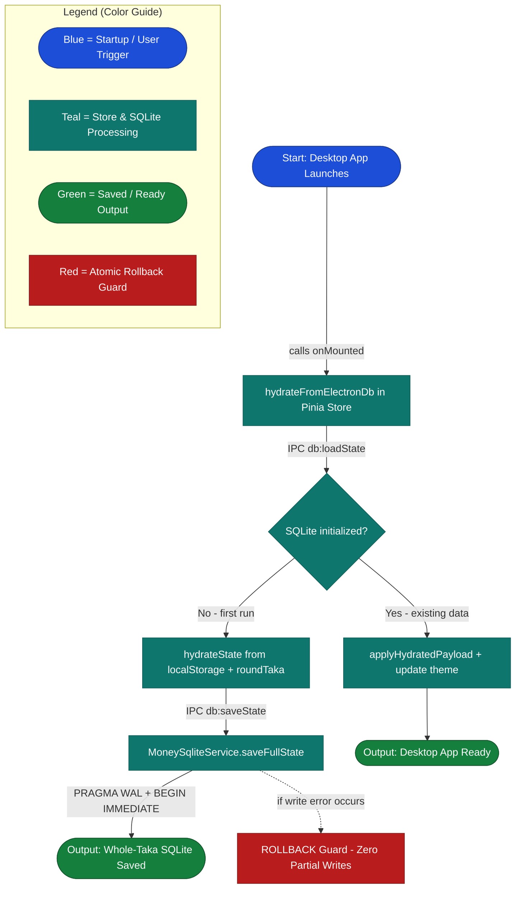
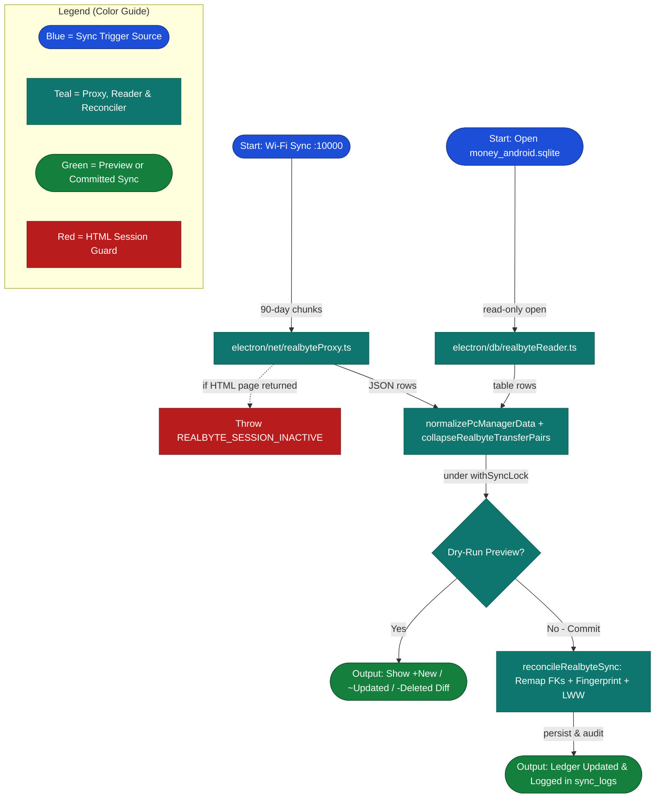
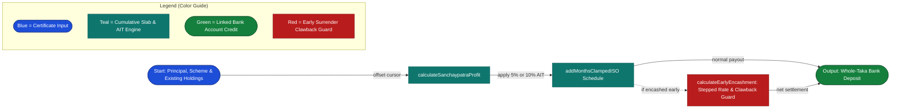
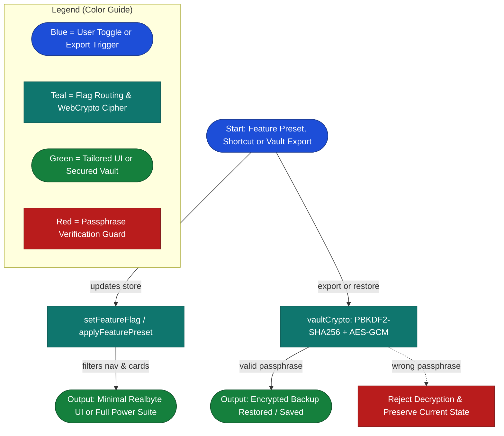

# Visual Feature & Change Log (`VISUAL_LOG.md`)
> **1-Line Summary:** Plain-English, color-coded Obsidian-compatible Mermaid flowcharts explaining how each core Money Manager feature and architectural upgrade works end to end.

## Feature & Change Flowcharts

### [VISUAL: Electron-SQLite-WAL-And-LocalStorage-Migration] | Aliases: electron startup, sqlite wal, localstorage migration, atomic save
> **1-Line Summary:** Migrates existing browser data once into `money_manager.sqlite` on startup and protects all whole-Taka writes inside atomic WAL transactions.

* **Plain-English Walkthrough:** When the desktop window opens, the Pinia store asks the Electron main process to load saved state from `money_manager.sqlite`. If the database is empty on first launch, it automatically copies any older browser `localStorage` data into SQLite so nothing is lost. Every later edit writes through an atomic `BEGIN IMMEDIATE / COMMIT` transaction using WAL mode, rolling back safely if an error occurs.

* **Code Anchors (Grep Targets):**
  * `src/store/index.ts` -> `hydrateFromElectronDb`, `persistState`
  * `electron/db/sqliteService.ts` -> `MoneySqliteService`, `saveFullState`, `loadFullState`
  * `shared/schema/v1_core.sql` -> `accounts`, `transactions`, `app_settings`

---

### [VISUAL: Realbyte-Dual-Path-Collision-Free-Sync] | Aliases: wifi sync, port 10000 proxy, binary sqlite reader, dry run preview, multiset sync
> **1-Line Summary:** Pulls phone records via CORS-free Wi-Fi proxy or binary `.sqlite` reader, previews diffs safely, and merges without duplicates or balance double-counting.

* **Plain-English Walkthrough:** Users can sync from Realbyte Android either over Wi-Fi (port `10000`) through Electron's Node proxy or by picking a Google Drive / Mega `money_android.sqlite` backup file. Transfer leg pairs (`DO_TYPE` 3 and 4) are collapsed into one transfer, foreign keys are remapped, and users can inspect a Dry-Run preview before committing. Finally, 4-tier multiset reconciliation (`externalUid`, ID, post-remap fingerprint, and LWW timestamp) updates the ledger and writes an entry to `sync_logs`.

* **Code Anchors (Grep Targets):**
  * `electron/net/realbyteProxy.ts` -> `fetchRealbyteTransactions`, `probeRealbyteEndpoints`
  * `electron/db/realbyteReader.ts` -> `readRealbyteBinarySqlite`
  * `src/modules/database/sqliteVault.ts` -> `collapseRealbyteTransferPairs`, `parseRealbyteSqliteVault`
  * `src/modules/sync/syncCoordinator.ts` -> `reconcileRealbyteSync`, `computeTransactionFingerprint`

---

### [VISUAL: Sanchaypatra-Cumulative-Slab-And-Early-Encashment] | Aliases: sanchaypatra slab, ait tax, early encashment, fdr dps maturity
> **1-Line Summary:** Offsets Sanchaypatra slab tiers by existing holdings, applies 5%/10% AIT tax, and simulates premature surrender adjustments or bank FDR/DPS maturity in whole Taka.

* **Plain-English Walkthrough:** When adding a Sanchaypatra certificate, the calculator shifts the starting slab cursor by total existing Sanchaypatra holdings before computing tiered gross profit and subtracting 5% or 10% Advance Income Tax (AIT). Payout dates advance month-end safely without UTC drift, and an Early Encashment flow simulates reduced statutory rates plus clawback adjustments before depositing the settlement into the linked bank account.

* **Code Anchors (Grep Targets):**
  * `src/modules/sanchaypatra/calculator.ts` -> `calculateSanchaypatraProfit`, `calculateEarlyEncashment`, `addMonthsClampedISO`
  * `src/modules/sanchaypatra/fdrDpsCalculator.ts` -> `calculateFdrMaturity`, `calculateDpsMaturity`
  * `src/store/index.ts` -> `addSanchaypatra`, `collectSanchaypatraPayout`, `encashSanchaypatra`

---

### [VISUAL: Adaptive-Desktop-Shell-Feature-Flags-And-Encrypted-Vault] | Aliases: feature flags, pure realbyte minimal mode, privacy mode, aes-gcm vault
> **1-Line Summary:** Controls workspace complexity through persisted `featureFlags` presets, global shortcuts, and PBKDF2 + AES-256-GCM encrypted backup vaults.

* **Plain-English Walkthrough:** Toggling **Pure Realbyte Minimal Mode**, **Full Suite**, or individual switches in Settings updates `store.featureFlags` so unused tabs and power cards stay hidden while core logging via the global keypad (`N` / `Ctrl+K`) and Privacy Mode (`Shift+P`) remain instant. Backups can be exported either as plain JSON or encrypted with a user passphrase using PBKDF2-SHA256 and AES-GCM.

* **Code Anchors (Grep Targets):**
  * `src/store/index.ts` -> `DEFAULT_FEATURE_FLAGS`, `applyFeaturePreset`, `setFeatureFlag`, `togglePrivacyMode`
  * `src/App.vue` -> `visibleTabs`, `handleGlobalShortcut`
  * `src/modules/exporters/vaultCrypto.ts` -> `encryptVaultJson`, `decryptVaultJson`
